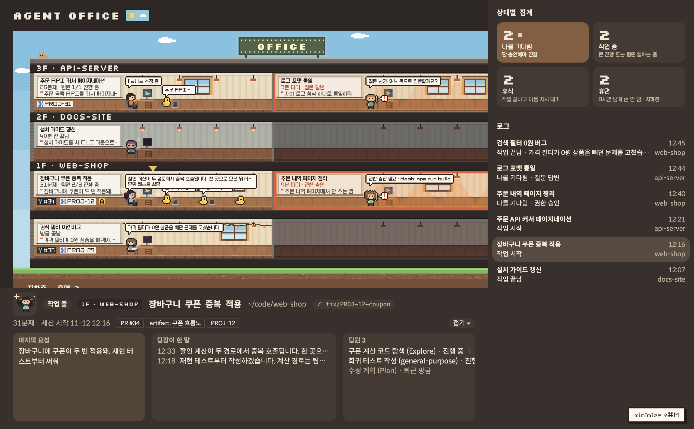
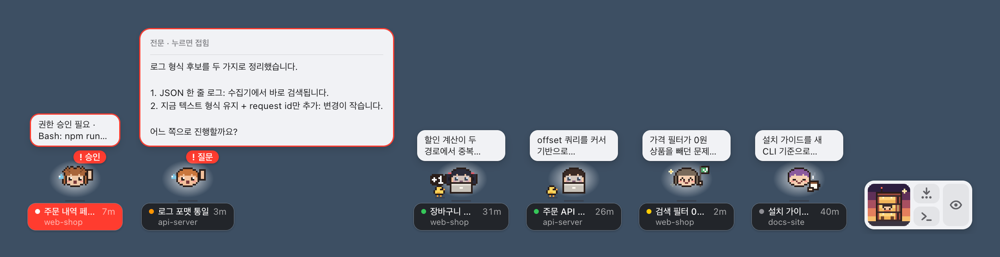

# Agent Office

이 PC에서 돌아가는 Claude Code 세션들의 현재 상태를 사무실 메타포로 한눈에 보여주는 로컬 화면.
터미널 하나가 **팀장**, 서브에이전트가 **팀원**이다. 폴더마다 층이 있고 팀마다 방이 있다. 용어는 [CONTEXT.md](CONTEXT.md)를 본다.



_큰 사무실: 층 = 폴더, 방 = 팀. 빨간 테두리는 나를 기다리는 팀이고, 아래는 고른 팀의 상세다(예시 데이터)._



_미니 모드: 세션마다 캐릭터가 바탕화면 위의 작은 창으로 뜬다(예시 데이터, 배경은 단색으로 합성)._

## 앱으로 설치 (macOS · Apple Silicon)

Node와 npm이 필요하다(개발은 Node 24). 한 번 빌드해 두면 서버를 따로 켜지 않는다. 앱을 열면 서버가 앱 안에서 같이 뜨고, 큰 창을 닫거나 종료하면 같이 꺼진다.

```sh
git clone https://github.com/namnameeroo/agent-office.git
cd agent-office
npm install    # Electron(빌드용 개발 의존성)을 받는다
npm run dist   # dist/Agent Office-darwin-arm64/Agent Office.app
mv "dist/Agent Office-darwin-arm64/Agent Office.app" /Applications/
```

- 로그인할 때 자동으로 띄우려면 시스템 설정 → 일반 → 로그인 항목에 추가한다.
- 업데이트는 자동이 아니다. `git pull && npm run dist` 후, 앱을 끄고 `/Applications`의 옛 앱을 지운 뒤 다시 옮긴다.
- Jira 칩을 링크로 만들려면 `~/.config/agent-office/config.json`에 `{ "jiraBase": "https://<조직>.atlassian.net" }`을 둔다.

## 실행 (개발)

처음 설치하는 환경이면 [docs/setup-checklist.md](docs/setup-checklist.md)를 위에서 아래로 확인한다.

```sh
node server.mjs
# Agent Office: http://127.0.0.1:4545
```

처음이면 `http://127.0.0.1:4545/?tour`로 화면 읽는 법을 본다. 예시 사무실 위에서 7단계로 요소마다 뜻을 짚는다(서버 데이터·저장값·터미널은 건드리지 않는다, `Esc`로 끝).

- Node 24에서 개발했다(v24.18.1). 의존성과 빌드 단계가 없다.
- 데스크탑 앱으로 띄우려면(처음 한 번 `npm install` — Electron은 이때만 쓰는 개발 의존성이다):

  ```sh
  npm run desktop   # 창 하나로 뜬다. 서버는 앱 안에서 같이 돈다. 4545가 이미 쓰이면 빈 포트에 앱 전용 서버를 띄운다
  npm run dist      # dist/Agent Office-darwin-arm64/Agent Office.app
  ```

  Dock 배지가 "나를 기다리는" 팀장 수다. 칩 링크는 기본 브라우저로 열린다. 설계: [ADR 0004](docs/adr/0004-desktop-shell.md)
- 환경 변수
  - `PORT`: 포트 (기본 `4545`)
  - `AGENT_OFFICE_CLAUDE_DIR`: 읽을 Claude 디렉터리 (기본 `~/.claude`)
  - `AGENT_OFFICE_JIRA_BASE`: Jira 주소. Jira 칩이 `<주소>/browse/<키>` 링크가 된다. 없으면 `~/.config/agent-office/config.json`의 `jiraBase`를 쓰고, 그것도 없으면 누를 수 없는 글자 칩이다.
- 한글 도트 글꼴 PF스타더스트는 재배포가 금지라 git에 없다. 없으면 Galmuri로 그린다. 받는 법:

  ```sh
  for f in PFStardust PFStardustBold PFStardustExtraBold; do curl -sSfL "https://cdn.jsdelivr.net/gh/projectnoonnu/2506-1@1.0/$f.woff2" -o "public/fonts/$f.woff2"; done
  ```

## 화면

- 가운데: 건물 단면. 층 = 폴더, 방 = 팀(자리 고정). 배율은 남는 공간에 맞춰 0.5 단위(레티나 기준)로 정한다.
  - 칠판: 팀 이름 / 상태와 경과 / 내가 방금 보낸 요청 첫 줄(앞에 “). 누르면 그 세션의 터미널(Orca 탭 · Ghostty 창, 그 밖은 앱만)이 앞으로 온다. 올리면 파란 테두리와 "터미널 ↗". → [ADR 0003](docs/adr/0003-board-click-focuses-terminal.md)
  - 칠판 아래 벽: 링크 오브젝트. PR = 초록 Y + #번호 칩, Jira = 파란 티켓 + 키 칩, artifact = 노란 [A]. 누르면 새 탭이다. 줄은 팀장 의자 앞(80 art px)에서 끝난다. 종류마다 최신 하나는 꼭 보이고(모자라면 Jira는 번호만), 남는 자리에 더 넣고, 못 넣은 수는 종류마다 "+N"이다.
  - 팀장 말풍선: 세션 본류(지금 하는 일)를 10자로 보여준다. 방을 누르면 방금 한 말과 지금 동작 2줄로 펼친다.
  - 나를 기다리는 방은 테두리가 빨갛고 5분·15분마다 세진다. 손 든 팀장 얼굴 옆에 `<[!]` 말풍선이 뜬다.
  - 방금 끝난 팀장은 커피를 마시고, 쉬는 팀장 머리 위로 작은 z가 떠오른다.
  - 휴면 팀은 땅 아래 지하층에 접혀 있다.
- 오른쪽: 상태별 집계(누르면 팀 목록)와 로그(상태가 바뀐 순간, 최근 2시간). 탭이 가려진 순간을 "여기까지 봄"으로 긋는다.
- 아래: 고른 팀의 상세. 접을 수 있고 접힌 상태는 기억한다.
  - 머리줄: [층 이름표][제목][경로][branch 칩]
  - 칸: 마지막 요청(인용 블록) · 팀장이 한 말(최근 8개 첫 줄) · 팀원
- 머리줄의 해·부엉이 스위치나 `N` 키로 낮·밤 팔레트를 바꾼다.
- **미니 모드**(데스크탑 앱, [ADR 0006](docs/adr/0006-mini-pets.md)): 큰 창 오른쪽 아래의 `minimize ⇧⌘M` 버튼이나 `Cmd+Shift+M`을 누르면 큰 창이 숨고, 휴면이 아닌 세션마다 **캐릭터가 바탕화면 위에 떠 있는 작은 투명 창**이 된다.
  - **캐릭터**: 큰 얼굴 아바타(노트북 = 작업 중, 커피 = 휴식, 손 들기 = 나를 기다림, 깃발 = 방금 끝남), 일하는 팀원은 병아리. 이름표는 상태 점 · 제목 · 이 상태로 얼마나(`7m`·`5h`·`5d`), 둘째 줄에 구역(› worktree). 점은 초록 = 작업 중, **초록 고리 = 턴은 끝났고 백그라운드 명령만 실행 중**, 주황 = 기다림, 노랑 = 방금 끝남. 기다릴 땐 머리 위에 이유 배지(`! 승인`·`! 질문`), 5분부터 이름표가 빨강.
  - **말풍선**: 늘 떠서 그 세션의 최근 응답을 두 줄로 보인다(기다릴 땐 무엇을 승인·답할지). 누르면 전문이 마크다운(굵게·코드·목록·링크)으로 펼쳐지고, 주소는 눌러서 기본 브라우저로 연다.
  - **올려두면**: 쪽지가 뜬다 — 위치(구역·worktree·브랜치) / 내 마지막 요청 / 지금 하는 동작 / PR·Jira 링크.
  - **조작**: 얼굴·이름표를 **끌어 옮기고**(자리 기억, 다른 모니터로도), **더블클릭**하면 터미널, **우클릭**하면 메뉴(터미널 앞으로·큰 사무실·말풍선 펼치기·응답 복사·종료).
  - **허브**: 타워 타일 창. 타워 = 큰 사무실, 아이콘 = 캐릭터 한 줄 정렬 · 새 터미널 · **캐릭터 한꺼번에 숨김/보임**(숨긴 동안 나를 기다리는 수를 빨간 배지로).
  - 서버가 끊기면 캐릭터가 반투명·정지. 큰 창으로 돌아오려면 `Cmd+Shift+M`, 허브의 타워, Dock 아이콘 클릭.

## 테스트

```sh
node --test
```

`*.test.mjs`를 자동으로 찾아 실행한다. 브라우저 모듈(`public/*.mjs`)은 `node --check`로 문법을 본다.

## 동작 방식

- 서버가 1초마다 스스로 사무실을 수집한다. 탭을 닫아 둬도 상태 변화 로그와 퇴근 기록이 쌓인다. `GET /api/state`는 마지막 수집 결과 `{ generatedAt, counts, desks, gone, events, lastEventAt }`를 준다.
- 로그와 퇴근 기록은 서버 메모리에 2시간 둔다. 서버를 재시작하면 사라진다.
- 팀장 상태는 `~/.claude/sessions/<pid>.json`의 `status`·`waitingFor`로 판정한다. 공식 문서에 없는 내부 파일이라 Claude Code 업데이트로 깨질 수 있다. → [ADR 0001](docs/adr/0001-read-status-from-sessions-files.md)
- 대화형 터미널과 백그라운드 세션(`claude agents`·`--bg`·`/bg`, `kind: "bg"`)을 읽는다. 백그라운드 세션의 칠판을 누르면 그 세션에 붙어 있는 `claude attach` 터미널로, 없으면 `claude agents`(agent view)를 띄운 터미널로 옮기고 `claude attach <jobId>`를 클립보드에 복사한다. 둘 다 없으면 복사한 뒤 supervisor를 띄운 터미널 앱만 앞으로 가져온다(새 탭에서 ⌘V). 쉰 시각은 대화 기록의 마지막 시각으로 잰다. → [ADR 0007](docs/adr/0007-background-sessions.md)
- 말풍선·팀원·구역·링크 칩은 세션 기록(jsonl)과 git 레포 위치로 계산한다. 링크 칩은 그 세션이 `gh pr create`로 만든 PR, Artifact 도구 결과, Jira 도구로 다룬 티켓만 쓴다(스펙 §4).
- 화면은 1초마다 `/api/state`를 폴링하고, DOM은 key로 노드를 재사용해 갱신한다. 그래서 갱신 중에도 클릭·포커스·스크롤·텍스트 선택이 유지된다. 건물 움직임은 canvas에 8fps로 칠한다.
- `POST /api/focus { pid }`는 그 세션의 터미널을 앞으로 가져온다. 결과는 `{ ok, app, partial? }` 또는 `{ ok: false, reason }`이고, 실패·일부만이면 화면 위에 이유를 4초 띄운다.
- 서버가 멈추면 화면은 마지막 데이터를 유지하고 "연결 끊김 · 마지막 갱신 HH:MM:SS"를 띄운다.

## 안전 원칙

- 읽기 전용이다. `~/.claude` 아래에 쓰지 않고 훅이나 설정도 바꾸지 않는다.
- 화면 밖을 움직이는 것은 세 가지다. 백그라운드 세션의 칠판은 `claude attach <jobId>`를 클립보드에 쓰고(pbcopy) 터미널 앱만 앞으로 가져온다(ADR 0007). 터미널 포커스(`/api/focus`)는 같은 화면(Origin 일치)의 POST만, 지금 수집한 세션 pid만 받고, 명령은 셸 없이 고정 인자로 실행한다(ADR 0003). 데스크탑 앱 허브의 "새 터미널"은 Ghostty를 앞으로 가져와 System Events로 ⌘N을 보낸다(손쉬운 사용 권한 필요). 세션에 글자를 입력하지는 않는다.
- `127.0.0.1`에만 바인딩하고, Host 헤더를 검사해 DNS 리바인딩을 막는다. 인증은 없으므로 같은 Mac의 다른 사용자 계정은 이 포트로 세션 내용을 읽을 수 있다. 여러 사람이 쓰는 Mac에서는 켜 두지 않는다.
- 외부 요청, 분석 도구, CDN을 쓰지 않는다. HTML 응답에 `Content-Security-Policy: default-src 'self'; frame-ancestors 'none'`을 붙여 브라우저가 이를 강제한다.
- 데스크탑 앱 창은 자기 서버 origin 밖으로 이동하지 않고, 링크는 `http(s)`만 기본 브라우저로 넘긴다. 4545를 다른 프로그램이 쥐고 있으면 그 서버를 쓰지 않는다.

## 구조

| 경로 | 역할 |
| --- | --- |
| `server.mjs` | HTTP 서버. 1초마다 수집, `GET /api/state`, `POST /api/focus`, 정적 파일(`public/`), CSP |
| `desktop/main.mjs` | Electron 껍데기. 서버를 앱 안에서 띄우고 창에 연다. 창 만들기(`openWindow`)는 서버 기동과 분리돼 있어 미니 모드 창을 더할 수 있다 |
| `desktop/preload.cjs` | 렌더러가 메인에 시킬 수 있는 것(`agentOffice.openOffice·openMini·fit·dragTo·dragEnd·onRoom·menu·arrange·newTerminal·togglePets`) |
| `desktop/pets.mjs` | 캐릭터 창 기하(빈 칸 배치·크기 맞춤·화면 가장자리 처리). 순수 함수 |
| `desktop/debug.mjs` | 검증용 탐침(환경변수로 켜는 캡처·로그). 평소에는 아무 일도 하지 않는다 |
| `scripts/smoke-pets.mjs` | `npm run smoke`: 개발용 Electron을 다른 포트·임시 저장 폴더로 띄워 캐릭터 창의 불변식(가운데 정렬, 가장자리에서 제자리, 숨김 토글, 링크·복사 등)을 단언한다. 떠 있는 앱과 저장된 캐릭터 위치는 건드리지 않는다 |
| `public/hub.mjs` | 본부(허브) 창: 픽셀 타워 엠블럼 + 사무실·정렬·새 터미널·캐릭터 숨김 토글 |
| `lib/focus.mjs` | 세션 pid → 터미널(Orca·Ghostty·앱) 판별과 포커스 이동 |
| `scripts/icon.mjs` | 앱 아이콘 생성. 26×26 픽셀 맵(마스코트 시안 B)을 정수 배율로 확대해 `desktop/icon.icns`로 묶는다(Node 내장 모듈 + `iconutil`). 맵을 고치면 `node scripts/icon.mjs`로 재생성 |
| `lib/sources.mjs` | 세션 파일·기록 읽기, 구역 계산, 사무실 수집(세션별 링크 캐시 포함) |
| `lib/office.mjs` | 상태 판정, 말풍선, 팀원, 사무실 뷰 모델 조립 |
| `lib/links.mjs` | 세션 기록에서 PR·Jira·artifact 링크 칩 추출 |
| `lib/history.mjs` | 상태 변화 로그와 퇴근한 팀장 2시간 보관 |
| `lib/static.mjs` | 정적 파일 경로 허용 목록 |
| `public/` | 화면. `index.html`, `style.css`, `app.mjs`(폴링·이벤트), `tower.mjs`(건물), `panels.mjs`(우측·하단), `common.mjs`, `dom.mjs`(key 재사용 갱신), `tour.mjs`(`/?tour` 튜토리얼: 예시 데이터 · spotlight), `api.mjs`(서버 호출), `mini.html`·`mini.mjs`·`mini.css`(미니 모드 캐릭터 창·허브), `mini-model.mjs`(미니 순수 판정·마크다운 토큰), `drag.mjs`(캐릭터·허브 공용 끌기), `mini-sprites.mjs`(큰 얼굴 아바타), `fonts/` |
| `test/` | `node --test` 테스트 |

## 문서

- [CONTEXT.md](CONTEXT.md): 용어집 (팀장·팀원·구역·상태·상태판·지하층·로그)
- [docs/adr/](docs/adr/): 결정 기록 (0001 상태 판정 출처 … 0006 미니 모드 캐릭터 창)
